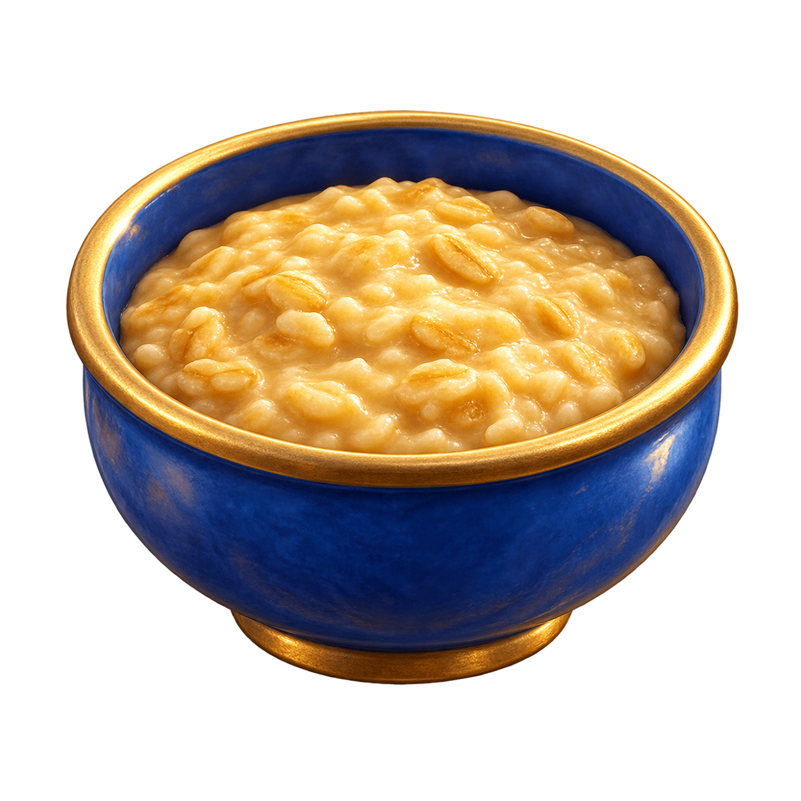
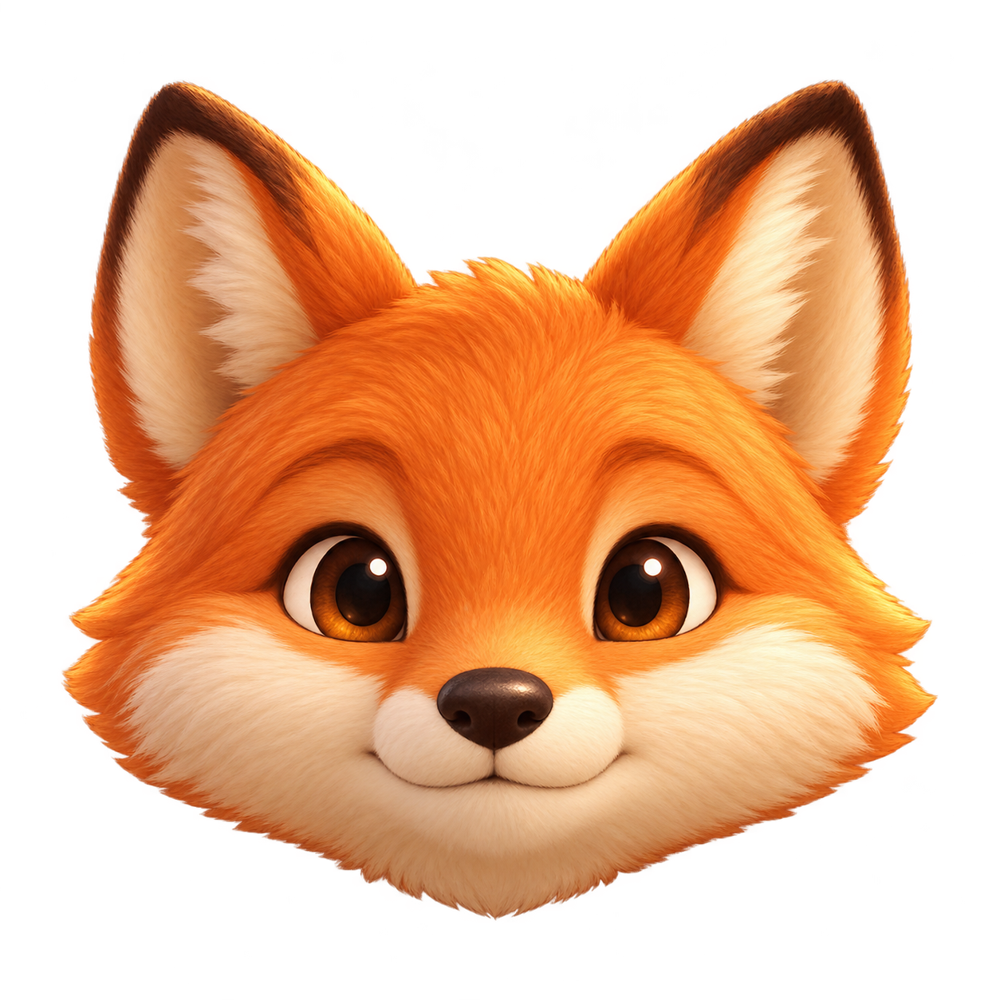

# Значки состояния питомца

Созданы 2026-10-17 встроенным инструментом imagegen по запросу пользователя. Не экспорт из Figma. Иконки обозначают категории; конкретное состояние указано соседним текстом.

PNG сохранены целиком, без обрезки и изменения размера. Runtime WebP: lossless=true, exact=true, method=6; RGBA каждого WebP совпадает с PNG.

## menu_status_energy

Prompt:

Create one isolated UI inventory icon for a premium children's fantasy storybook mobile game about an orange fox. Warm, softly sculpted 3D illustration, simple bold silhouette, subtle painterly texture, tasteful and readable at just 24 pixels. Square canvas. Object fills 80 percent of canvas, fully visible with even transparent margins. True transparent background. No text, numbers, badge, enclosing tile, rectangle, background scenery, sparkles, lightning bolts or floating decorative particles. Restrained details, warm directional lighting, crisp object silhouette. Subject: a single upright orange fox paw, pads facing the viewer, four rounded toes with warm dark brown pads and a larger central paw pad, soft cream fur edging. A natural charming animal paw, not a flat symbol or emoji. Represents strength and energy.

## menu_status_satiety

Prompt:

Create one isolated UI inventory icon for a premium children's fantasy storybook mobile game about an orange fox. Warm, softly sculpted 3D illustration, simple bold silhouette, subtle painterly texture, tasteful and readable at just 24 pixels. Square canvas. Object fills 80 percent of canvas, fully visible with even transparent margins. True transparent background. No text, numbers, badge, enclosing tile, rectangle, background scenery, sparkles, lightning bolts or floating decorative particles. Restrained details, warm directional lighting, crisp object silhouette. Subject: one small deep blue ceramic food bowl with a subtle warm brass rim, seen slightly from above, with a modest appetizing serving of golden porridge. No cutlery, no steam, no lettering, no face on bowl. Simple broad silhouette. Represents satiety.

## menu_status_mood

Prompt:

Create one isolated UI inventory icon for a premium children's fantasy storybook mobile game about an orange fox. Warm, softly sculpted 3D illustration, simple bold silhouette, subtle painterly texture, tasteful and readable at just 24 pixels. Square canvas. Object fills 80 percent of canvas, fully visible with even transparent margins. True transparent background. No text, numbers, badge, enclosing tile, rectangle, background scenery, sparkles, lightning bolts or floating decorative particles. Restrained details, warm directional lighting, crisp object silhouette. Subject: a friendly orange fox head viewed straight on, two upright ears, cream cheeks, dark brown eyes and small dark nose. Calm gentle expression with closed mouth, without exaggerated smile, tears or eyebrows. Head only, no body, no accessories. Represents mood as a category.
