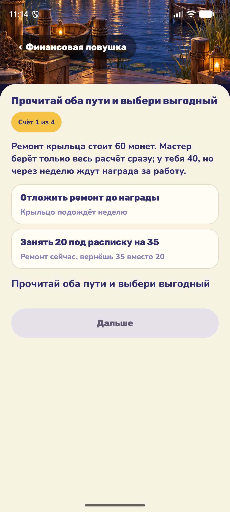

# Финансовые мини-игры — тестовый предпросмотр

Обновлено: 2026-10-16. Статус: **тест** — механики доступны отдельными карточками
в разделе «Дела» и пока не назначены реальным делам. Решения:
[FINMINI-D-001](decisions.md) (добавить), [FINMINI-D-002](decisions.md)
(дела не трогать, тестовый вход), [FINMINI-D-003](decisions.md)
(пользователь оставил шесть механик из девяти).

## Как открыть

Главное меню → **«Дела»** → секция **«Финансовые игры · тест»** → карточка игры.
Игры самодостаточны: не требуют предложенных дел, срока и сил.

Общие правила тестового входа:

- демо-монеты в итоговом листе ничего не начисляют — игровой баланс не меняется;
- аналитика ответов не пишется (как у всех механик, кроме «Сверки счетов»);
- обратная связь раунда живёт до явного «Дальше» / «Завершить»
  (MINIGAME-UI-D-003), без автопереходов;
- партия переживает поворот экрана; повторный вход в карточку начинает заново;
- в реальном деле награда считалась бы как доля верных раундов от максимума
  дела (D-078 / BALANCE-D-003) — в тестовом входе показывается только демо-сумма.

Секция в «Дела»:

## Игры

### 1. Выгодно или нет? (`BARGAIN`)

Партия: 5 раундов. В каждом раунде двое торговцев предлагают **одинаковый
товар** разным количеством и за разную полную цену: «2 шт. за 16 монет»
против «4 шт. за 48 монет». Итог всегда делится на количество нацело, цены
за штуку заметно различаются. Верная попытка — выбрано предложение с
**меньшей ценой за одну штуку**; после ответа подсвечивается выгодная
карточка.

Навык: сравнивать предложения по удельной цене, а не по сумме на ярлыке —
не вестись на кажущуюся выгоду.

### 2. Нужда или желание? (`NEED_WANT`)

Партия: 8 предметов, ровно половина — необходимое. Предмет показывается
целиком (например, «тёплый плащ», «украшение из ракушек», «запас воды»),
игрок относит его кнопкой к **«Необходимое»** или **«Желание»**. Пул
фиксированный, состав и порядок каждой партии новые. Верная попытка —
предмет отнесён к своей группе.

Навык: отличать потребности (еда, одежда, здоровье, дорога) от простых
желаний.

### 3. Настоящая скидка (`DISCOUNT`)

Партия: 5 ярлыков. На ярлыке товар, зачёркнутая «старая» цена и новая цена,
а также **настоящая прежняя цена** этого товара («в другой лавке он стоит
77 монет»). Скидка честная, только если новая цена **ниже настоящей
прежней**; у ловушек старая цена нарочито завышена, и «со скидкой» товар
на деле дороже прежнего. Верная попытка — верно определено, честный ли
ярлык («Скидка настоящая» / «Скидка хитрая»).

Навык: критически оценивать скидки и не доверять зачёркнутой цене.

### 4. Монетный баланс (`BALANCE`)

Партия: 3 недели. В каждой — фиксированный доход и список трат на весах
бюджета. Траты двух видов: **обязательные** (хлеб, ремонт сапог, лекарства)
и необязательные (сладости, игрушки). Игрок нажатием снимает необязательные
траты, пока расходы не станут не больше доходов, и подтверждает «Проверить
баланс». Раунд засчитан, если баланс сошёлся и ни одна обязательная трата
не снята; подтверждённый перегас или снятое «необходимое» — ошибка. Без
отказов расходы всегда больше дохода, у каждой недели решение есть.

Навык: базовый принцип баланса «расходы ≤ доходы» и то, что экономят на
желаниях, а не на необходимом.

### 5. Финансовая ловушка (`LOAN`)

Партия: 4 сценария с фиксированными числами, порядок каждый раз новый.
В сценарии два пути с денежными последствиями: взять монеты сейчас под
расписку и вернуть больше — или накопить/подождать самому; купить сразу
или дождаться скидки. Игрок читает оба пути и выбирает; верная попытка —
выбран путь, который **оставит больше монет**, после выбора показывается
итог с числами («Заём стоит 50 монет: возвращать придётся на 50 больше,
чем взял»).

Навык: цена заёмных денег и отложенное вознаграждение (в эту механику
слиты сценарии №6 «Финансовая ловушка» и №12 «Выбор во времени»).

### 6. Лишняя покупка (`PACKING`)

Партия: 3 набора. В каждом — цель поездки («Ночной поход к обсерватории»,
«Рыбалка с Бобром на рассвете», «Починка верстака с Тико») и четыре
предмета; ровно один для цели не нужен. Игрок убирает лишний тапом; после
ответа лишний предмет подсвечивается. Составы фиксированные, порядок
предметов и наборов случайный.

Навык: собирать покупки под цель, избегать импульсивных покупок.

## Что вошло и что нет

Из двенадцати предложенных игр по [FINMINI-D-003](decisions.md) оставлены
шесть: №1 «Выгодно или нет?», №3 «Нужда или желание?», №4 «Настоящая
скидка», №5 «Монетный баланс», №6 «Финансовая ловушка», №8 «Лишняя
покупка». Удалены полностью: №2 «Три баночки», №7 «Собери накопления»,
№11 «Найди переплату» (а также слитый с №2 вариант №10 «Раздели добычу»).
№9 «Цена ошибки» не реализовывалась — сравнение вариантов прошлого решения
уже делает настоящий Хроноскоп на реальных решениях игрока.

Формулировки источников приведены к миру игры: торговцы — лавка и ярмарка,
«гоблин-торговец» заменён торговцем, «магические» предметы — обычными
вещами сеттинга.

## Технические заметки

- Состояния механик: `core/game/src/main/kotlin/ru/nksk/lctapp/domain/minigame/`
  (`BargainState`, `NeedWantState`, `DiscountState`, `BalanceState`,
  `LoanState`, `PackingState`), каждый со своими JVM-тестами.
- Экраны и Hilt ViewModel: `feature/tasks/ui` (`*GameScreen.kt`,
  `*ViewModel.kt`), общий каркас `FinGameBoard` и блок обратной связи
  `FinFeedback`; партии восстанавливаются через `SavedStateHandle`.
- Тестовые маршруты: `feature/tasks/navigation/TasksNavigation.kt`
  (`tasks_fin_*`), карточки — `DeedsScreen` (список `financialDemoGames`).
- Назначение механик делам пока не выполнялось; проект распределения
  сохранён в [FINMINI-D-001](decisions.md) и применяется отдельным решением.

## Открытые скриншоты

Здесь показаны секция в «Дела» и «Финансовая ловушка». Скриншоты остальных
пяти досок будут добавлены после пересъёмки на эмуляторе — при съёмке через
adb-тапы часть кадров захватила не те экраны.
